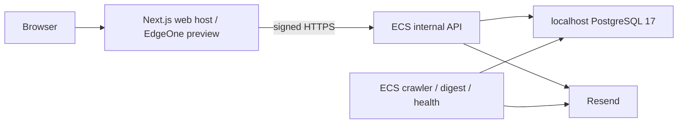

# HITnotice

A campus notification aggregation and email alert service for Harbin Institute of Technology.

This branch, `migration/edgeone-ready`, prepares the canonical PostgreSQL application for **EdgeOne preview import**. The public site is currently in maintenance and the production cutover is incomplete. Preparing this source branch does not deploy a website, open database writers, or resume scheduled jobs.

## Features

- Aggregation of publicly accessible campus announcements from the source registry.
- User-selected sources and weekday or weekly digest preferences.
- Subscription confirmation and unsubscribe links.
- Stable notice hashes and preserved `first_seen_at` for digest windows.
- Transactional subscription updates, atomic delivery/run claims, and delivery history.
- Crawler and digest health monitoring.
- Optional ECS-side WeChat draft tooling.

The normal scheduling design is weekday digest delivery at 20:00 Asia/Shanghai and weekly delivery on Friday. These are business rules, not a claim that paused production schedules have resumed.

## Architecture



The web host proxies subscriptions, unsubscriptions, and authorized admin reads through the signed ECS API. It does not connect directly to PostgreSQL or Supabase, and it does not send email. Subscription confirmation is handled by the ECS service. The retired Resend webhook stays disabled with HTTP 410.

ECS and the web host share one repository and canonical commit family, but have different runtime roles and environment variables. The ECS write gate remains configurable and fails closed by default; web routes are normal proxies, not permanently hard-coded maintenance handlers.

## EdgeOne preview preparation

See [EdgeOne deployment instructions](docs/EDGEONE_DEPLOYMENT.md) for repository import, environment ownership, framework requirements, and the read-only PoC sequence. Do not bind the production domain during the PoC.

- Repository: `guanfeilee/HITNotice`
- Branch: `migration/edgeone-ready`
- Framework: Next.js App Router, locked Next.js 16.2.10
- Install: `npm ci`
- Build: `npm run build`
- Generic Node.js start: `npm start`

Use the Next.js full-stack preset, including server routes. A static-only export cannot implement the signed API proxy or dynamic admin page. This branch does not include Vercel regions, Vercel SDKs, or a new public diagnostic endpoint.

## Environment ownership

`.env.example` contains names and blank placeholders grouped by runtime. Do not copy the ECS-only section into EdgeOne.

Web host:
- `HITNOTICE_ECS_API_BASE_URL`
- `HITNOTICE_INTERNAL_API_SECRET`
- `ADMIN_CHECK_TOKEN` for the private admin page
- `NEXT_PUBLIC_SITE_URL` is optional here; current web code does not read it. ECS email-link generation uses it separately.

ECS API and jobs:
- `DATABASE_URL`
- `RESEND_API_KEY`, `EMAIL_FROM`
- `HEALTH_REPORT_EMAIL`
- `WECHAT_APP_ID`, `WECHAT_APP_SECRET` only for separately enabled WeChat tooling
- `HITNOTICE_WRITE_MODE`, `HITNOTICE_ECS_API_PORT`, `HITNOTICE_RELEASE_COMMIT`

Neither Supabase credentials nor database/email credentials are required on the web host. Missing internal API configuration permits a build but causes valid subscription requests to fail safely with 503. It never falls back to another database.

## Local development and verification

```bash
npm ci
npm run dev
```

Run credential-free checks in a clean checkout:

```bash
npm test
npm run lint
npm run typecheck
npm run build
npm run test:web-proxy
npm run test:preview-safety
```

The integration tests use a local mock ECS API and a local built Next.js server. They do not call a real database, send emails, run a crawler or digest job, or create WeChat drafts. Actual PostgreSQL write tests are separate and require an explicitly isolated test database; see [PostgreSQL testing](docs/POSTGRESQL_TESTING.md).

Do not provision production credentials just to build or test a web preview. Stage-specific scripts under `ops/` and historical Phase A–E documents are audit/runbook material, not build hooks or instructions to mutate a live environment.

## Baseline records

- [Baseline synchronization audit](docs/EDGEONE_BASELINE_AUDIT.md)
- [Canonical PostgreSQL schema](docs/POSTGRESQL_SCHEMA_BASELINE.md)
- [Phase B repository report](docs/PHASE_B_POSTGRESQL_REPOSITORY.md)

Delta digest WIP remains on its separate preservation branch and is excluded here. The dirty production root is not the source for this branch.

## Privacy and project status

HITnotice stores email addresses and notification preferences required for subscriptions. It aggregates public notice pages and does not require student IDs, real names, phone numbers, or university account credentials.

This is an independent student project, not an official Harbin Institute of Technology platform. Verify official information through the original university sources.

## License

MIT; see [LICENSE](LICENSE).
