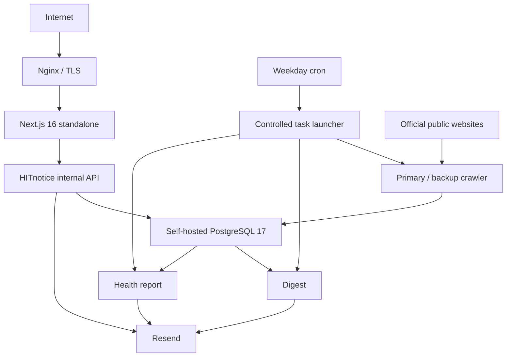

# HITnotice

A student-developed service that collects public Harbin Institute of Technology announcements and sends personalized email summaries.

**Website: [hitnotice.cn](https://hitnotice.cn)**

## Features

- Follow selected university, office, school and department announcement sources.
- Choose weekday or weekly email digests.
- Receive a confirmation email on the first successful subscription.
- Unsubscribe through the confirmation page linked in each email.
- Deduplicate notices by source and normalized URL; use `first_seen_at` to identify newly discovered notices.
- Track source freshness, digest outcomes and operational health.

The enabled source registry is maintained in [`lib/source-registry.ts`](lib/source-registry.ts).

## Production architecture

Production runs on **Alibaba Cloud ECS, Ubuntu 22.04**. Nginx terminates TLS with Let's Encrypt certificates. The Next.js 16 standalone website calls a signed local HITnotice API; that API accesses self-hosted PostgreSQL 17. Web and API processes are managed independently by systemd.



The web server has no direct database or email-send credential. The API handles subscriptions, unsubscribe requests, admin reads and first-subscription confirmation mail. Scheduled jobs access PostgreSQL directly through separate task identities; they do not depend on the web or API process being up.

Web, API and tasks use independent immutable releases. A documentation change does not require redeploying every component. Production is no longer hosted on Vercel or backed by Supabase; references to them in migration records describe historical stages.

## Schedule

All times are **Asia/Shanghai (Beijing time)**, Monday–Friday:

| Time | Task |
|---|---|
| 19:45 | Primary crawl |
| 19:50 | Backup crawl |
| 20:00 | Digest |
| 20:10 | Health report |

On Fridays, the digest task processes both `weekday_digest` and `weekly_digest`, with separate delivery histories and idempotency keys. Each subscription selects one frequency.

## Notifications and email

Resend sends first-subscription confirmations, weekday digests, weekly digests and the maintainer health report.

- Email addresses are trimmed and normalized to lowercase.
- Subscriptions and their selected sources are saved in one PostgreSQL transaction.
- Confirmation email is attempted after a new subscription commits. Repeating a subscription, changing sources or resubscribing does not send another confirmation.
- Confirmation-mail failure does not roll back the subscription. It currently has no persistent delivery tracking.
- Digests use each user's last accepted delivery window for the same digest type to catch up on missed notices. New subscribers without delivery history use the default day/week window. Empty digests are skipped.
- Digest delivery claims, provider idempotency keys, suppression checks and an exclusive workflow lock protect against duplicate or unsafe sends.
- Resend acceptance is not the same as inbox receipt. The historical webhook endpoint is retired; current digest records do not promise independent delivery confirmation.

## Reliability

Partial source failures are retained in crawl history and reported as degraded. A failed backup attempt does not invalidate an earlier fresh success. Digest sending requires a fresh successful crawl for every configured source; missing freshness refuses that digest run without permanently pausing the workflow.

System-level failures still trigger a global protective pause: for example, database persistence failure, crawler crashes, uncertain digest sending, or at least 25% of sources failing (7 of the current 26). Health remains allowed under a global pause and reports its reason and reference. Health failures do not pause crawler or digest. Health reporting remains subject to database/network availability and its daily reservation against duplicate sends.

See [pause policy and operational boundaries](docs/PAUSE_POLICY.md) and [crawler reliability](docs/CRAWLER_RELIABILITY.md).

## Deployment and configuration

Production uses ECS, Nginx, systemd, PostgreSQL 17, cron, Resend and Let's Encrypt. Release manifests are verified before an atomic task-release switch. Never edit a live release in place, store credentials in Git, or use production jobs as failure tests.

Configuration is separated by component:

| Component | Required configuration |
|---|---|
| Web | Local API base URL, internal signing secret, admin token, public site URL |
| API | PostgreSQL connection, internal signing secret, API port, release identifier, `HITNOTICE_WRITE_MODE=open`, Resend key and sender, public site URL |
| Crawler | Its database identity |
| Digest | Its database identity, Resend key and sender, public site URL |
| Health | Its read-only database identity, Resend key and sender, maintainer recipient, public site URL |

API readiness must check both the write gate and the actual database identity's transaction defaults. A healthy read endpoint alone does not prove that subscriptions can be saved. Keep the API and crawler/digest writer identities separate from the read-only health identity.

See the [PostgreSQL schema baseline](docs/POSTGRESQL_SCHEMA_BASELINE.md). Historical SQL under `supabase/` must not be replayed against the current database.

## Local development and verification

Use Node.js 22 and install the locked dependencies:

```sh
npm ci
npm run dev
```

For subscription/admin development, run the local API separately against a disposable PostgreSQL database and configure the website's internal API URL and signing secret. Do not load production credentials into tests.

```sh
npm run lint
npm run typecheck
npm test
npm run build
npm run test:launcher-reliability
```

[Isolated PostgreSQL testing](docs/POSTGRESQL_TESTING.md) explains the guarded database suite. The daily workflow, crawler and paused-health integration tests require a disposable test database and mocked network/email. Production crawler, digest and health commands must not be manually run for verification.

## Documentation

- [Current pause policy](docs/PAUSE_POLICY.md)
- [Crawler reliability](docs/CRAWLER_RELIABILITY.md)
- [PostgreSQL schema](docs/POSTGRESQL_SCHEMA_BASELINE.md)
- [Isolated testing](docs/POSTGRESQL_TESTING.md)
- `docs/PHASE_*` and the legacy email guide are historical migration evidence, not current deployment instructions.

## Privacy

HITnotice stores email addresses and subscription preferences needed to deliver digests. It does not collect real names, student IDs, phone numbers, campus card numbers or unified identity credentials. It only aggregates public announcement pages and does not access private or login-protected information.

## Disclaimer

HITnotice is an independent student-developed service, **not an official platform of Harbin Institute of Technology**. All official information should be verified through university websites.

## License

MIT License.
