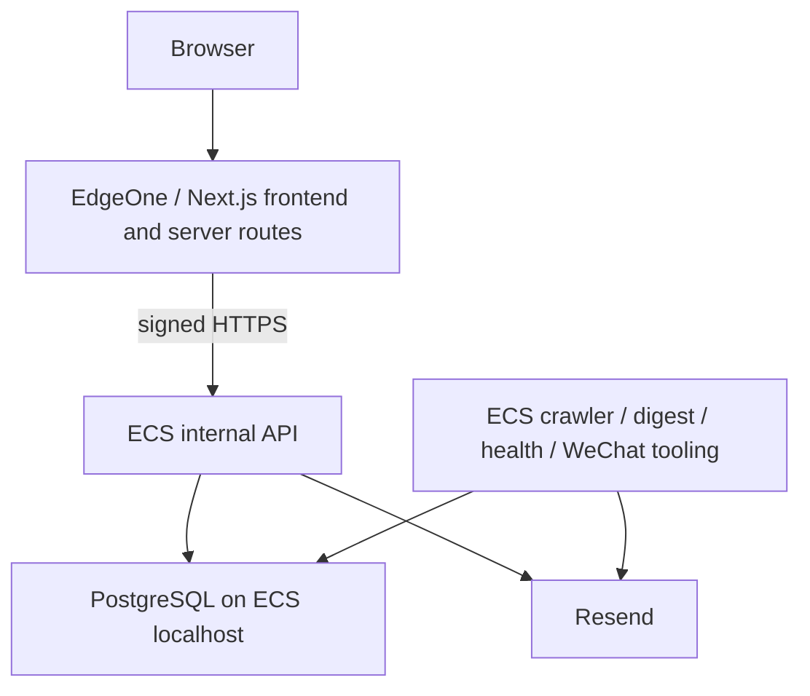

# HITnotice EdgeOne GitHub Baseline Synchronization Report

Audit date: 2026-09-06, Asia/Shanghai. This checked-in report records the reviewed source, local validation, and production protection evidence. The final handoff additionally records the new commit SHA, remote tree verification, and post-push comparison with `main`.

## Source Baseline Decision

Selected base: **`5f10504bbe41964d5e48551ee961cc14d4fdf0da`**. It is the complete Phase A/B canonical implementation plus approved Phase C/D operational history and Phase E write-safety gates. All 282 release source files match this Git commit. The dirty `/root/HITNotice` directory was used only for read-only comparison; no source was copied from it.

The branch preserves that commit family and adds one preparation commit. Six inherited commits are ahead of the existing GitHub main; the preparation commit makes seven. This is one new commit in this task, not a rewrite/squash of the approved migration history.

## Git audit

Parents below are abbreviated unambiguously within this repository. Branch names describe the inspected local branch graph; an ancestor can be reachable from multiple branches.

| Commit | Parent | Branch / location | Purpose and classification | Baseline decision |
| --- | --- | --- | --- | --- |
| `208fa71ae5381442925850c2949c964b167a3160` | `dae5f30` | `main`, `origin/main`, production root HEAD | Existing digest health code; old Supabase baseline | Common ancestor; never update main |
| `1b5472db43f27077e5df4018f23c6c3cc2ea1d14` | `208fa71` | Ancestor of canonical and older ECS migration branches | Signed ECS internal API, web proxy, deployment source and tests | Included through canonical ancestry |
| `785cb6713a055bd61aedc33098e5394586429c83` | `1b5472d` | `codex/canonical-baseline` | Phase A code: shared validation, safe proxy, admin, health client, test guards | Included |
| `13d46e7cea1d2c1ff128696666cd299f2f2524bd` | `785cb67` | `codex/postgresql-repository` | Phase B code: pg repositories, transactions, canonical schema, job access, Supabase application removal | Included |
| `9c2ff041d4c3260109460f9936fed198c0df2592` | `13d46e7` | `codex/ecs-postgresql-installation` | Phase C docs, sanitized aggregate evidence, installation/backup/restore scripts; no application code change | Included as historical runbook/source; never executed here |
| `d2cfbb8c373860c7eb711aa7ad2f48779525107a` | `9c2ff04` | `codex/production-data-rehearsal` | Phase D docs, sanitized results and guarded rehearsal scripts; no application code change | Included as historical runbook/source; real data artifacts excluded |
| `5f10504bbe41964d5e48551ee961cc14d4fdf0da` | `d2cfbb8` | Candidate base; ancestor of `codex/production-cutover`; current ECS release | Phase E configurable write gate, signed synthetic intake, guarded operations, tests | Selected base; runtime gate preserved |
| `2f0f3b315647da25c19f41f1f0ee20918c736aa0` | `5f10504` | Ancestor of `codex/production-cutover` | Safe transport diagnostics plus six temporary cutover-operation scripts | Whole commit excluded; only generic transport diagnostics selected and further restricted to fixed error-name/code allowlists |
| `df6b4d254326458ee85986799990a496bede980a` | `d2cfbb8` | `codex/cutover-maintenance` | Web subscribe/unsubscribe hard-coded maintenance 503 | Excluded; normal proxy routes retained |
| `a2c1a2aa79e3b13642e71a7bf092fe228118d750` | `208fa71` | `codex/delta-digest-preservation` | Delta implementation and preservation patches; WIP, not production ready | Preserved separately and excluded |
| `98104743c980b49474ae3223f3dbd89c3b11576d` | `2f0f3b3` | `codex/production-cutover` | Aborted-cutover report, Phase E aggregate evidence, abort/deployment operations | Excluded; only current status summarized in this report |

The older `codex/ecs-api-migration` branch also contains Vercel-region, DNS and temporary HTTP probe commits. Those are not ancestors of the selected canonical base and are excluded. No force push or unrelated branch overwrite is part of this synchronization.

## Production Root Safety and ECS Release Comparison

Read-only before/after observations confirmed:

- Production root HEAD remains `208fa71ae5381442925850c2949c964b167a3160`.
- Exact porcelain Git status is unchanged: four modified tracked files and four untracked paths, including preserved Delta files and generated TypeScript metadata.
- All 211 protected root file hashes are identical, including an environment-file hash. Only equality/counts are included here; no environment contents or environment hashes are published.
- Release path and current symlink remain `/opt/hitnotice-api/releases/5f10504bbe41964d5e48551ee961cc14d4fdf0da`.
- All 282 release source files match the Git commit; zero missing, changed, or unexpected source files.
- `node_modules`, runtime environment files, generated build output, logs and TypeScript build metadata are excluded from release source comparison.
- API active state, process ID and restart counter are unchanged; business crontab contents remain identical and paused.

No checkout, stash, reset, pull, commit, or file mutation was performed in production root. No service restart or database query was required for this audit. Database health/data-restore facts remain the earlier Phase D/E evidence, not newly executed database tests.

## Delta WIP

**Preserved; excluded.** The separate preservation commit/branch remains intact. The final baseline has no `lib/digest/delta.ts`, `scripts/send-delta-digest.ts`, Delta scheduler, Delta package command, or Delta confirmation/send wiring. Existing non-Delta digest and retry source remain canonical ECS tasks and were not executed.

## Maintenance / Diagnostic Changes

| Classification | Result |
| --- | --- |
| Included | Configurable ECS Phase E maintenance/synthetic/open safety gate, signed request checks, default closed writers |
| Excluded | `df6b4d2` fixed-503 web handlers; `2f0f3b3` one-off deployment/probe/job/synthetic/freeze scripts; `9810474` evidence and operations; old Vercel-region/DNS/HTTP probes |
| Modified | Generic transport log fields from `2f0f3b3`: configuration booleans, upstream status, fixed allowlists of error names and network codes; arbitrary exception names/messages/causes, URL, headers, body and credentials are not logged |

Local built-web tests prove successful subscribe/unsubscribe proxy responses with a mock backend. Production maintenance is controlled by the backend, not a permanent frontend 503 replacement. Opening writers remains outside this task.

## EdgeOne-ready Architecture

The baseline includes `app/`, `components/`, `public/`, `lib/db/`, canonical PostgreSQL schema/grants, and crawler/digest/health/WeChat source. Web subscribe/unsubscribe and admin use the internal API client. Internal subscribe/unsubscribe/admin/health routes exist. Resend webhook remains 410. Subscription confirmation email belongs to the ECS subscription service.

**EdgeOne production DB dependency on Supabase: NO.** Production application libraries and task entrypoints have no Supabase REST access. Historical SQL under `supabase/migrations/`, Phase A-era history, and migration runbooks under `ops/` are provenance, not web application dependencies. The ECS environment example was corrected to remove obsolete Supabase credential names.

**EdgeOne direct PostgreSQL dependency: NO.** The canonical test walks the complete web import graph and rejects `pg`, `lib/db`, `DATABASE_URL`, and retired Supabase/webhook code. `pg` remains installed in the shared repository for ECS runtime roles; installation is not a web connection. The browser/web host neither gets `DATABASE_URL` nor connects to its own localhost database.

**Hard Vercel dependency: NO.** No Vercel SDK, KV/blob/config service, analytics/speed-insights or `waitUntil` dependency was found. `VERCEL_ENV` appears only as an additional legacy production denial condition in test guards and the corresponding fixture tests; independent environment/address/opt-in guards remain portable. Historical client-ID labels containing `vercel` are protocol identifiers rather than platform APIs and remain compatible. No root middleware, Server Actions, forced Edge runtime, or custom Next.js rewrite/redirect configuration is used. Server signing requires Node APIs, so the full-stack Node-capable preset is required.

## Environment Variables

Only names are listed. Details are in [EDGEONE_DEPLOYMENT.md](EDGEONE_DEPLOYMENT.md).

| Classification | Names |
| --- | --- |
| EdgeOne runtime business routes required; build optional | `HITNOTICE_ECS_API_BASE_URL`, `HITNOTICE_INTERNAL_API_SECRET` |
| EdgeOne optional admin | `ADMIN_CHECK_TOKEN` |
| Optional on web; current consumer is ECS email-link generation | `NEXT_PUBLIC_SITE_URL` |
| Optional separately executed PoC helper | `HITNOTICE_ECS_API_CHECK_BASE_URL`, `HITNOTICE_ECS_API_CHECK_ADMIN` |
| ECS only; not needed on EdgeOne | `DATABASE_URL`, `RESEND_API_KEY`, `EMAIL_FROM`, `HEALTH_REPORT_EMAIL`, `WECHAT_APP_ID`, `WECHAT_APP_SECRET`, `HITNOTICE_WRITE_MODE`, `HITNOTICE_ECS_API_PORT`, `HITNOTICE_RELEASE_COMMIT` |
| Not required by canonical application | `SUPABASE_SERVICE_ROLE_KEY`, `NEXT_PUBLIC_SUPABASE_URL`, `NEXT_PUBLIC_SUPABASE_ANON_KEY`, `RESEND_WEBHOOK_SECRET` |

No additional secret is needed to build. Both checked-in environment examples contain blank placeholders. Missing API configuration allows build/static pages and gives safe 503 for valid business submissions, 404 for disabled admin, and 410 for the retired webhook.

## Tests

Local verification used Node 24.15.0, npm 11.12.1, locked Next.js 16.2.10. The Node engine range is declared as `>=22.11.0 <25`. No dependency version was changed; lockfile changes only mirror root engine metadata.

| Check | Result / scope |
| --- | --- |
| `npm ci` | PASS, clean isolated worktree; dedicated temporary npm cache after existing shared-cache permission failure |
| `npm test` | PASS: internal API, canonical import boundaries/signatures/failure mapping/log redaction, first-seen, digest-group pure logic, mocked health/digest reliability, cutover gate |
| `npm run lint` | PASS |
| `npm run typecheck` | PASS |
| `npm run build` | PASS without production secrets or API configuration; static and dynamic routes emitted |
| `npm run test:web-proxy` | PASS: built Next.js plus localhost mocked signed ECS API; success/error/admin/auth/webhook behaviors |
| `npm run test:preview-safety` | PASS: built Next.js with no API/database/email configuration; static pages, safe 503, admin 404, webhook 410 |
| `git diff --check` | PASS |
| Dependency audit | **FINDINGS: 8 high, 0 critical; not a clean audit** |
| Secret and artifact scan | PASS after fixture/template review; no real secrets or private artifacts found in candidate or newly published ancestry |

Tests requiring IPC/local servers initially encountered sandbox restrictions and were rerun with the required execution approval. No production database write tests, crawler jobs, digest/retry/delta commands, email, health send or WeChat operation were executed. Tests named for those modules exercise local fixtures/mocks and pure logic only.

## Dependency Audit Findings

The npm registry audit returned eight high-severity affected package entries: `brace-expansion`, `browserslist`, `js-yaml`, `nanoid`, `next`, `postcss`, `sharp`, and `undici`. Entries can aggregate multiple advisories and include transitive/tooling dependencies; this count is not a determination that every advisory is exploitable in this application. The registry reports fixes available. No broad dependency update or automatic audit-fix was folded into the canonical synchronization.

The sanitized [dependency audit result](edgeone-evidence/dependency-audit.json) records the per-package ranges and advisory references. Resolve the relevant findings and rerun the checks before any production rollout or production-secret provisioning. Preview readiness here means source import/build and controlled isolated PoC, not security clearance for public production.

## GitHub Secrets / Migration Artifacts Audit

The scan covered the candidate files and all unique file blobs reachable from the six previously unpublished migration commits between `main` and the selected base. It did not merely scan the final diff. Checks included password/secret assignments, credential-bearing PostgreSQL URLs, JWT/provider token formats, private-key headers, environment-file paths, dump/pgpass/private-log/private-JSON names, and known production/backup/credential path references.

Pattern hits were inspected and resolved as blank environment examples, redacted connection shapes, explicit localhost-only test credentials, fixed mock signing strings, or source expressions reading protected credentials. The retained JSON evidence contains schema, counts, aggregate distributions, timing, and archive/table checksum summaries; it contains no raw production records, full subscription identities, credential values, or environment snapshots. No raw row manifest is included.

References to protected ECS paths such as `/root/.config` and `/var/backups` occur in historical code/docs; the actual credential files, directories, dumps, logs and snapshots are not Git objects. Public host/project identifiers in historical connection helpers are not passwords and do not establish a web dependency. No production credentials were loaded into the local build worktree. `.gitignore` additionally excludes environment variants, dumps, pgpass, private JSON/JSONL/log artifacts and backups.

**No secrets committed / no real dump committed**, within the reviewed candidate and introduced-history scope. Private production safety manifests remain outside Git; only sanitized equality/count results are published.

## GitHub and shared canonical family

Only `migration/edgeone-ready` is an authorized push target. Main is pinned for comparison to `208fa71ae5381442925850c2949c964b167a3160`; no main update, merge or force push is allowed. The remote branch did not exist during the initial audit. The final handoff verifies the pushed SHA/tree, lockfile, Next.js source and deployment docs through remote Git objects, and reports the exact file/line difference from main.

The EdgeOne branch contains all shared code required by the current ECS PostgreSQL release. Future web and ECS releases should be built from a reviewed commit in this same canonical family, with role-specific configuration and checks. This is a recommendation for later release provenance, not authorization to build/deploy/restart the current ECS service. The current ECS code remains exactly the selected base. The preparation changes are docs/config/tests and constrained transport observability, with no database schema or repository changes relative to that release.

## EdgeOne Import Readiness

**READY FOR EDGEONE PREVIEW IMPORT**, subject to the isolation and dependency findings above. Actual EdgeOne adapter/build execution and deployed EdgeOne-to-ECS connectivity remain unverified. Follow the documented sequence: repository import, selected branch, non-production environment, build, static pages, signed health/admin, separately authorized synthetic subscription, and no production-domain binding.

## Final Safety Confirmation

- Production root and Delta WIP preserved; current ECS release unchanged; API not restarted.
- PostgreSQL, Supabase, Vercel production, DNS and EdgeOne were not changed.
- Business cron was not resumed; crawler/digest/retry/delta/health-send jobs were not run.
- No email was sent; no WeChat draft was created.
- No merge or push to main; no Delta source included.
- No real credentials, database dump, raw production record manifest, private cutover JSON, private log or environment snapshot is included in the branch.
