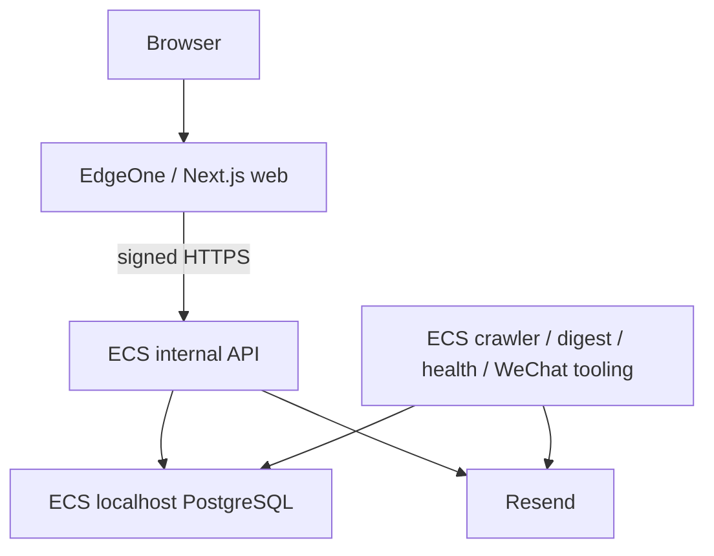

# EdgeOne preview deployment preparation

Status: **READY FOR EDGEONE PREVIEW IMPORT**, limited to an isolated preview. No EdgeOne deployment or production domain change was performed by this synchronization. Public production remains in maintenance; production cutover is incomplete. The existing dependency lock has eight high-severity npm audit findings, documented in [the baseline audit](EDGEONE_BASELINE_AUDIT.md). Resolve and validate those before production approval; do not provision production secrets just to build the preview.

## Repository and build

| Setting | Selection |
| --- | --- |
| Repository | `guanfeilee/HITNotice` |
| Branch | `migration/edgeone-ready` |
| Root directory | Repository root |
| Framework | Next.js full-stack / App Router |
| Locked framework | Next.js 16.2.10 |
| Install command | `npm ci` |
| Build command | `npm run build` |
| Framework output | `.next`, handled by the Next.js preset |
| Node.js | Select a supported version satisfying `>=22.11.0 <25`; 22.11.0 is a documented common option |
| Generic Node host start | `npm start` |

EdgeOne's [Next.js guide](https://pages.edgeone.ai/document/framework-nextjs) documents Next.js 16, App Router, SSR and route-handler support. Its [build guide](https://pages.edgeone.ai/document/build-guide) documents Node version selection and separate Preview/Production environments. Verify the actual console options at import time. Local checks used Node 24.15.0 and npm 11.12.1; the EdgeOne adapter and hosted runtime have not been exercised here.

Keep the framework preset's full-stack behavior. Do not use static export or replace `.next` with a static `out` directory. Signed server calls depend on Node APIs (`node:crypto`, `Buffer`); use the Node server runtime rather than forcing these routes into an Edge-only runtime. The project has no root middleware/proxy, Server Actions, configured Next.js redirects/rewrites, or explicit Edge runtime. Dynamic routes are required for subscriptions, unsubscribe, and admin reads. No platform-specific config file is necessary for this source preparation.

## Runtime ownership



The web routes call the signed internal API. They do not import PostgreSQL repositories or send confirmation email; ECS owns those operations. PostgreSQL and native rendering dependencies remain in the shared package because ECS uses the same repository, not because the web application opens database connections. EdgeOne localhost is not ECS localhost.

## Environment names only

The following table intentionally contains no environment values.

| Variable | EdgeOne requirement | Meaning |
| --- | --- | --- |
| `HITNOTICE_ECS_API_BASE_URL` | Required for business routes at runtime; optional for build/static preview | HTTPS origin for the intended ECS API; use a separately controlled preview backend for PoC |
| `HITNOTICE_INTERNAL_API_SECRET` | Required with the API origin for business routes | Server-only signing secret, at least 32 characters; never expose through a public variable |
| `ADMIN_CHECK_TOKEN` | Optional; required to enable private admin access | Missing/invalid access remains hidden with 404 |
| `NEXT_PUBLIC_SITE_URL` | Optional on EdgeOne; not read by current web code | Current consumer is ECS email-link generation; configure independently there for any future mail-enabled environment |

Do not place these on EdgeOne:

| Variables | Owner / reason |
| --- | --- |
| `DATABASE_URL` | ECS PostgreSQL runtime only |
| `RESEND_API_KEY`, `EMAIL_FROM` | ECS API/jobs send email |
| `HEALTH_REPORT_EMAIL` | ECS health reporting only |
| `WECHAT_APP_ID`, `WECHAT_APP_SECRET` | Separately authorized ECS WeChat tooling only |
| `HITNOTICE_WRITE_MODE`, `HITNOTICE_ECS_API_PORT`, `HITNOTICE_RELEASE_COMMIT` | ECS API operation only |
| `SUPABASE_SERVICE_ROLE_KEY`, `NEXT_PUBLIC_SUPABASE_URL`, `NEXT_PUBLIC_SUPABASE_ANON_KEY` | Not required by canonical application runtimes |
| `RESEND_WEBHOOK_SECRET` | Not required; retired webhook returns 410 |

The names `HITNOTICE_ECS_API_CHECK_BASE_URL` and `HITNOTICE_ECS_API_CHECK_ADMIN` are optional inputs for the separately executed read-only PoC helper, not website requirements. Runtime-provided `NODE_ENV` must remain under the hosting framework's control.

Both `.env.example` and `deploy/ecs-api.env.example` contain blank placeholders. The second file is ECS-only. No real environment files belong in Git.

## Preview-safe behavior and write gate

Building without any internal API configuration succeeds. Valid `/api/subscribe` and `/api/unsubscribe` requests fail closed with 503 when that configuration is missing or invalid. There is no Supabase fallback, local database fallback, or fabricated success. Static pages remain available; disabled admin access stays 404; `/api/webhooks/resend` stays 410.

With a configured and available backend, these are normal proxy routes. The separate hard-coded maintenance web commit is excluded. The ECS write gate from the approved canonical release remains intact: missing/unknown mode is maintenance, and synthetic/open modes require separately controlled server configuration. Importing this branch does not open the current production gate. Do not set writer controls on EdgeOne.

## PoC order — a later, separately authorized task

1. Import the GitHub repository into a preview project.
2. Select `migration/edgeone-ready`, never substitute `main`.
3. Configure non-production Preview environment settings. A build/static-page preview can start with the API variables absent. For backend testing, use a controlled preview ECS endpoint and its server-only signing secret.
4. Build with the full-stack Next.js preset and locked dependencies. Confirm the hosted Node version and adapter behavior.
5. Verify static pages and the safe missing-configuration responses before connecting a backend.
6. Verify **EdgeOne runtime → ECS signed health/admin**. Reuse `checkEcsApi` in `lib/internal-api/health-check.ts` from a server-side PoC function, or run `check:ecs-api` only in an environment that actually represents EdgeOne egress. Explicitly configure `HITNOTICE_ECS_API_CHECK_BASE_URL`; its existing default is ECS-local loopback and is unsuitable for EdgeOne. Enable `HITNOTICE_ECS_API_CHECK_ADMIN` only when admin reads are intended. The helper sends signed GETs to `/internal/health` and `/internal/admin/notices` and reports statuses/counts only. A successful laptop/build-container check alone does not establish deployed function connectivity. No new public health route is necessary.
7. Only after those reads pass, test synthetic subscribe under a separate authorization covering the isolated target and email suppression/mock transport. Do not send a normal form submission to production as a connectivity test. The currently frozen production backend must remain frozen during preview preparation.
8. **Do not bind `hitnotice.cn` yet.** Domain/DNS changes, production environment setup, dependency remediation, writer opening, and scheduler restoration require their own reviewed production phase.

## Verification commands

```bash
npm ci
npm test
npm run lint
npm run typecheck
npm run build
npm run test:web-proxy
npm run test:preview-safety
npm audit
```

The first two integration commands after build start local Next.js/mock services only. They require no production credentials. `npm audit` currently reports findings rather than a clean exit. Do not run database-reset tests, business jobs, or historical `ops/` scripts as deployment/build hooks. Historical Supabase migration scripts and SQL are retained as reviewed source/runbook history; they are not application dependencies or instructions to access production during this PoC.
