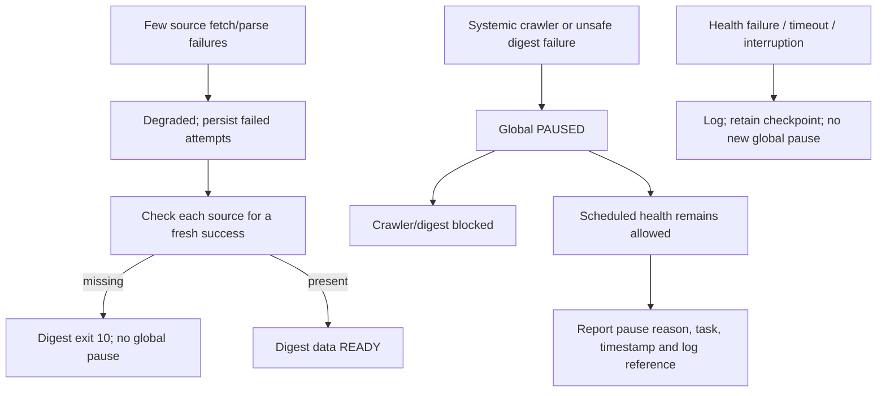

# Task failure and pause policy

Current architecture: ECS hosts independent Nginx, Next.js standalone and signed API services; cron launches database-backed crawler/digest/health jobs directly. Web/API failures do not write the task pause marker. The services have no `OnFailure`, `PartOf` or `BindsTo` coupling to the daily launcher in the audited production configuration.

## Before this change

The launcher rejected all scheduled jobs when PAUSED existed. The POST guard also rejected health mail. Every nonzero health exit, timeout or interruption could create PAUSED, so a reporting failure could stop future crawling and digests and then prevent reporting the pause itself. The crawler partial-failure and digest-readiness exceptions were already implemented.

## Current behavior

| Failure | Outcome |
|---|---|
| Fewer than 25% of source fetch/parse attempts fail | Complete as degraded; keep failed crawl rows |
| Primary success followed by backup failure | Earlier fresh success still satisfies digest |
| Same source fails both attempts | Digest refuses with exit 10; future crawler remains allowed |
| At least 25% fail (7/26) | Fatal crawler exit; global PAUSED |
| Notice/crawl persistence error, database or lock failure, crawler crash | Fatal crawler exit; global PAUSED |
| Digest freshness failure | Exit 10 before run/delivery claims; no global PAUSED |
| Digest send/accepted-writeback uncertainty, unresolved delivery/history | Stop and protect against automatic replay |
| Confirmed suppression lookup failure or subscription changed before claim | Exit 11; refuse current run without global pause |
| Unknown digest nonzero exit, DB/configuration failure | Conservative global protection; do not assume sending state is safe |
| Health failure, suppression failure, timeout or signal | Restricted log/checkpoint; never create or replace PAUSED |
| Web/API failure or restart | No direct daily pause side effect; shared ECS/database resource failures may independently affect jobs |
| Invalid manifest/configuration before launch | Fail closed before executing child; existing pre-launch behavior does not create PAUSED |

The 25% threshold, source selection, notices, digest windows/claims, suppression decisions and subscription logic are unchanged. A configured source without fresh success blocks the digest, but not the next scheduled recovery crawl.

## Health under PAUSED

**YES: a scheduled health job can run while the workflow is paused.** Both launcher and POST guard have a health-only exception. This does not authorize crawler/digest writes or sends under PAUSED.

The root launcher supplies bounded, allowlisted pause metadata (task, reason, time, log reference). Old markers without a timestamp use their mtime; malformed/oversized metadata is reported as unavailable, not blindly included in mail. Text, HTML, preview and restricted logs include the workflow state. Automatic failure pauses are not described as intentional maintenance.

The guard still enforces a single configured health recipient, exact sender, health-only subject, no cc/bcc, and no repeated provider key. The health command still reserves a daily checkpoint before sending and does not resend an uncertain attempt. Health SQL remains read-only. Interruption does not overwrite the evidence of the original incident.

This is permission to attempt reporting, not an out-of-band availability guarantee. PostgreSQL/lock or Resend failure can still prevent a report; such failures remain in restricted logs and do not stop future recovery jobs. A reserved same-day health attempt is not automatically repeated. Health uses the existing 20:10 weekday schedule, not a new alert scheduler.

## Verification

- `npm test` includes pause text/HTML and actual POST/SQL guard tests with no real network.
- `npm run test:launcher-reliability` executes actual launcher control flow against temporary files and mocked children, including PAUSED health, blocked crawler/digest, health errors/signals and preserved evidence.
- `npm run test:service-isolation` exercises local API startup failure and a local built web port-conflict failure; no production service is crashed.
- The PostgreSQL crawler suite covers fresh success, two-round missing success, threshold and persistence failures using actual repositories and mocked network.
- The daily integration suite runs the actual health CLI plus POST guard against a disposable PostgreSQL database and mocked Resend while PAUSED is simulated. It checks that one report succeeds and the daily checkpoint refuses a repeat.

## Deployment boundary

Archive the tested commit into a new immutable task release, generate its source manifest, reuse pinned Linux dependencies, verify all files and atomically switch daily-current. Keep cron, API/Web releases, API write-mode and credentials, database settings and historical records unchanged. Deployment verification does not manually execute production crawler, digest or health.

Digest exit 11 is limited to an explicit allowlist of confirmed pre-delivery-claim eligibility failures. The failed/partial run is still recorded and cannot be automatically replayed at the same cutoff; a later scheduled cutoff can catch up from persisted accepted windows. Failure to persist the run status, pending/failed deliveries, send/writeback uncertainty and all unclassified exceptions remain fatal. No historical row is reset and no automatic send retry is added.
