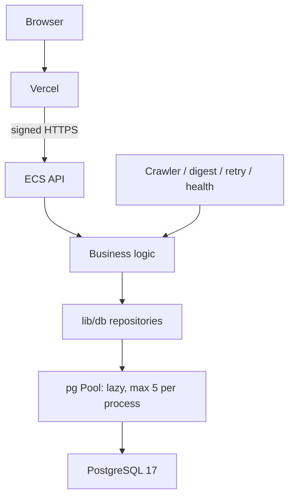

# HITnotice Phase B PostgreSQL Repository Report

Status: **READY FOR PHASE C — ECS PostgreSQL Installation**. This is readiness for the separately authorized installation phase, not approval for data migration, deployment or cutover.

## Safety

- Base: `785cb6713a055bd61aedc33098e5394586429c83` (Phase A canonical).
- Branch: `codex/postgresql-repository`.
- Worktree: `/private/tmp/hitnotice-postgresql-repository-20260905`.
- Delta preservation: `a2c1a2aa79e3b13642e71a7bf092fe228118d750`, unchanged and not merged.
- Work used local source plus a disposable loopback Docker PostgreSQL 17 instance. No production SSH, Supabase reads/dump or real user fixtures were needed in this phase. The original dirty worktree was not edited. No branch was pushed or deployed.
- The committed source replaces database access, but deployed production was not switched or re-audited during this phase. Prior Phase A/production reports remain historical evidence, not fresh live-state verification.

## PostgreSQL Architecture



The web import graph has no database dependency or DATABASE_URL. ECS and CLI services share parameterized repositories. SQL is confined to lib/db and guarded integration setup/assertions. No ORM. Transactions acquire one PoolClient, BEGIN, COMMIT or ROLLBACK, then release in finally. Errors expose a fixed operation and safe code; raw PostgreSQL detail, SQL, connection URL and parameters are not propagated.

## Schema Baseline

Tested PostgreSQL **17.11**; target major **17**. Empty-database execution passed: **7 tables, 82 columns, 29 indexes, 7 PK, 2 FK, 2 UNIQUE constraints, 36 CHECK constraints, 3 triggers, 1 business function**. Tests also verify key index definitions, unconditional hash uniqueness/nullability, partial token/provider-ID uniqueness, cascading FKs, ownership, no RLS and no additional extensions.

The schema preserves all seven historical tables, JSONB, UUID, timestamptz, defaults and trigger behavior. Native gen_random_uuid is sufficient; pgcrypto and the three other Supabase platform extensions are not copied. Runtime role permissions are restricted per table; DDL, TRUNCATE and inappropriate deletes fail in real tests. See [schema and roles](POSTGRESQL_SCHEMA_BASELINE.md).

## Supabase Removal Status

**Active production DB code dependency on Supabase: NO.** This applies to the Phase B branch. **Actual production is unchanged**, not claimed to be PostgreSQL-backed.

Removed the SDK dependency, five Supabase access modules, obsolete write-test script/command and REST migration fallbacks. Remaining Supabase terms under lib/app/scripts are only four test assertions/descriptions. The crawler now requires DATABASE_URL. [Complete dependency audit](POSTGRESQL_DEPENDENCY_AUDIT.md) lists every remaining match and access path. Historical migrations remain reference-only.

## Subscription Transaction

```text
BEGIN
INSERT subscription ON CONFLICT(email) DO NOTHING RETURNING
if existing: UPDATE subscription (acquires row lock)
DELETE old subscription_sources
INSERT complete deduplicated source set
COMMIT
```

A new row's insertion holds its lock; conflicting inserts wait for that transaction. Existing rows are locked by UPDATE until the entire source replacement commits. A CHECK failure after parent update and source deletion rolls the entire transaction back, preserving the parent and former source set. A failing new subscription leaves no parent row.

Tokens are generated by Node crypto only for new/missing-token cases and existing tokens are preserved. A fresh candidate is discarded for ordinary existing-token updates. Reactivation preserves existing unsubscribe history. First-subscription confirmation is attempted only after commit by the transaction that inserted the row. Concurrent requests do not both claim first insertion; confirmation delivery is still not exactly-once and a post-commit crash can miss it.

## Concurrent Subscribe Behavior

**Last successful database transaction wins.** Competing same-email requests produce one subscription and one complete source set corresponding to the final committed frequency. No interleaved/empty partial associations, duplicate parent or orphan source was observed. Same-email conflicts are handled in SQL, not exposed as unique errors. There is no indefinite retry loop; lock/statement timeouts bound waits. Subsequent unsubscribe locks the row, distinguishes not-found and preserves the first stored unsubscribed_at and the token on repeated calls.

## Crawler Upsert

Input is deduplicated by hash; the final input for a duplicate hash wins. A single ordered advisory-lock query serializes overlapping hash writers, followed by batched INSERT ON CONFLICT(hash) DO NOTHING RETURNING and a conditional batched UPDATE in the same transaction. This avoids N PATCH calls and unstable xmax-based insert detection.

- inserted: rows actually inserted.
- updated: preexisting rows whose mutable fields differ, using IS DISTINCT FROM (including NULL).
- unchanged: distinct input hashes requiring neither insert nor update.
- first_seen_at, id, created_at and hash never change on a conflict update.
- Identical crawls perform no UPDATE and do not refresh updated_at.
- Legacy insertedOrUpdated remains inserted + updated; recorded crawl new_count now uses inserted only.

The production path does not fall back to nullable hash or URL identity. Low-level insert/update/read compatibility names remain behind the repository boundary.

## Digest Claim Semantics

New delivery: INSERT ON CONFLICT DO NOTHING RETURNING. Conflict handling covers both window and idempotency unique indexes, then locates the exact subscription/type/start/end record. An unrelated key conflict cannot silently claim another row. Real testing found and fixed the multiple-unique-index race from an initially narrower conflict target.

Retry: one atomic UPDATE requires status=failed AND resend_email_id IS NULL. Only one active retry claim wins; accepted/sent/delivered/permanent states or any provider ID cannot return to pending. Existing idempotency keys remain untouched. Period-only lookup throws on ambiguity instead of picking an arbitrary window.

Accepted recording requires an existing intended target. Pending or failed rows without provider ID can record accepted truth, preserving key and timestamps as appropriate. Repeating the same provider ID in an accepted/final state is a no-op; a different ID is rejected. Delivered is never downgraded. A late failure updates only pending rows without provider ID and cannot overwrite accepted truth. A missing accepted/failure target throws. Historical run metadata is merged rather than discarded.

Scheduled runs use atomic INSERT ON CONFLICT DO NOTHING RETURNING with the four-column, non-partial unique index. finish requires status=running; the second finish throws explicitly. Delta remains excluded; no delta command, migration behavior or tests were added.

Digest selection keeps source grouping, active weekday/weekly subscriptions, prior accepted-window catch-up, permanent blocks, and `[first_seen_at >= start, first_seen_at < end]`. UTC start/end boundary and microsecond tests pass. Historical webhook table reads remain available, but the HTTP route stays 410.

## Email Idempotency

The sequence remains **DB claim → external Resend HTTP → DB accepted/failure record**. There is no HTTP call inside a database transaction. Database uniqueness/claims, the unchanged Resend idempotency key and application reconciliation jointly reduce duplicates; no cross-system ACID or absolute exactly-once guarantee is claimed.

Existing retry defaults to dry-run. Unit tests protect retry decisions; integration tests use the real repository with a mocked sender, confirming one send across concurrent workers and no resend after accepted. Pending uncertainty after a process/network failure still requires reconciliation; it is not automatically reset or blindly retried.

## Health and Admin

Health generation remains read-only. Notice source counts use SQL COUNT/GROUP BY without the former 10,000-row truncation. Delivery health classification intentionally retains the existing business function over a period-scoped read; no broad health-rule rewrite. Admin source filter is parameterized, first_seen_at DESC and LIMIT 200 are fixed; authorization remains upstream. Existing health/digest business regression tests pass.

## Connection Pool

Recommended starting settings: max 5 per process, idleTimeoutMillis 30000, connectionTimeoutMillis 5000, statement_timeout 15000 and lock_timeout 5000. API + crawler + digest + health have at most 20 application connections; reserve roughly 10 within max_connections ~30. Avoid overlapping extra CLI workers without revisiting this budget.

Pool creation is lazy and missing configuration raises a safe DATABASE_URL_MISSING error. No DB configuration or connectivity is required for build. CLI main paths close pools in finally, with allowExitOnIdle as a fallback; API shutdown drains HTTP then calls pool.end. This is a conservative design for the future 1.6 GiB ECS, not a measured production memory/capacity result.

## Tests

| Verification | Result |
|---|---|
| npm ci with committed lockfile | PASS |
| npm run lint | PASS |
| npm run typecheck | PASS |
| npm test | PASS: API security, 16 canonical groups, first_seen_at, digest groups, health, digest reliability/retry |
| npm run build without DB credentials | PASS: 11 generated routes/pages |
| Built Next.js proxy integration | PASS: localhost signed mock ECS, no database/mail credentials |
| PostgreSQL schema/roles/repositories | PASS |
| Subscription rollback, concurrent replacement, repeated unsubscribe | PASS |
| New/retry delivery claims, accepted/late-failure race, scheduled claims and duplicate finish | PASS |
| JSONB NULL/object/missing field, UTC and microseconds | PASS |
| SQLSTATE 23505/23503/23514/40001/40P01 | PASS, including real serialization failure/deadlock |
| Mocked email with real concurrent repository workers | PASS |
| Explicit imported UUID/timestamp preservation | PASS with synthetic data only |
| PostgreSQL suite total | **18 test groups PASS** |
| Performance sanity | PASS; numbers below |

The opted-in suite checks both connection URLs before connecting, accepts only loopback hitnotice_test databases, requires NODE_ENV=test and ALLOW_TEST_DATABASE_RESET=1, applies schema as owner, tests business operations as runtime, cleans fixture tables in finally and closes connections. [Reproduction instructions](POSTGRESQL_TESTING.md).

## Performance Sanity

Synthetic fixture: 1,200 notices; 80 subscriptions; 400 associations; 1,800 email deliveries; 2,000 crawl runs. Running/success digest runs and historical webhook fixtures are validated in the functional phase, which is cleared before the performance fixture.

| Operation | Local elapsed milliseconds |
|---|---:|
| Active subscriptions | 0.98 |
| Digest notices | 2.33 |
| Batched crawler upsert, 100 notices | 4.61 |
| Delivery claim | 1.76 |
| Health source aggregates | 0.86 |

Single-run localhost sanity figures, not production benchmarks. [Machine-readable result](POSTGRESQL_TEST_RESULTS.json). The initial per-hash locking version took ~33 ms for 100 rows; batching ordered locks reduced round trips. No production performance claim follows from these synthetic measurements.

## Remaining Risks

- PostgreSQL has **not** been installed on production ECS.
- Supabase has **not** been dumped/restored; real production data restore compatibility remains unverified.
- Vercel canonical has **not** been deployed; ECS backend has **not** been switched.
- Cutover, backups, rollback, backup restoration, credentials, server configuration and single-writer coordination remain Phase C/D work.
- Actual historical timestamp/key/nullability anomalies and non-millisecond delivery endpoints require restore rehearsal. PostgreSQL and the driver preserve microseconds, but existing JS Date retry/window interfaces cannot represent sub-millisecond endpoints exactly. Inventory and resolve this before cutover; do not round restored identities blindly.
- DB and external email state cannot be atomic. Uncertain pending/accepted persistence needs reconciliation and provider idempotency retention must be considered during later operations.
- The same small ECS would host application and database; disk capacity, memory, backup isolation and failure recovery require Phase C validation.
- Vercel→ECS signed HTTPS latency/reliability still requires deployment-stage verification.
- Delta remains WIP/not production ready on its unchanged preservation branch.

## Phase C Recommendation

**READY FOR PHASE C — ECS PostgreSQL Installation.** No code/isolation-test blocker remains for preparing the database host. This does not authorize installation now and does not assert readiness for data cutover. Phase C must separately establish role/network restrictions, resource limits, backups/restore practice and observability; Phase D must validate actual restore and coordinate a rollback-capable single-writer switch.

## Final Safety Confirmation

- [x] Did not modify `/root/HITNotice` or overwrite delta preservation.
- [x] Did not modify production ECS release, `/etc/hitnotice` or production environment.
- [x] Did not deploy Vercel or ECS.
- [x] Did not modify/dump production Supabase or restore production data.
- [x] Did not install PostgreSQL on production ECS.
- [x] Did not modify/restore cron or change systemd/nginx.
- [x] Did not run formal crawler, digest, retry send, delta send or health notifications.
- [x] Did not send mail, change real subscriptions/unsubscriptions, create WeChat drafts or replay webhooks.
- [x] Did not merge or push main; no remote push at all.
- [x] Used only synthetic database records and mocked mail in isolated tests; independently checked all seven tables contain zero remaining fixture rows, then stopped the local test container.
